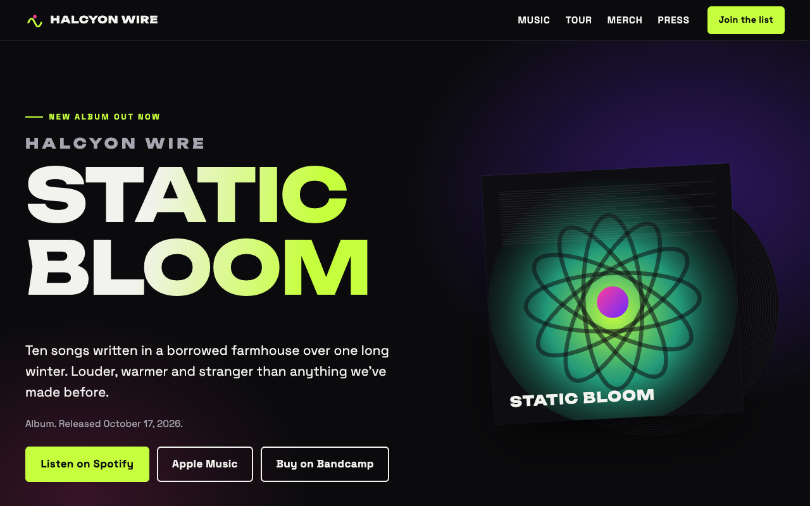

# Halcyon Wire: music website template

A bold, dark website template for bands and artists: a hero for your latest release, click-to-load players, tour dates with ticket links, merch, a press kit and a mailing list signup. Built with Astro as a fully static site.



[](https://console.cloudzyro.com/new?repo=https://github.com/Cloudzyro/template-music)

## What's included

- Hero for your latest release with streaming and buy links and generated cover art
- Music section with Spotify, SoundCloud and Apple Music players that load only when a visitor clicks, so no third-party scripts or cookies run before that
- Tour dates from one data file, with ticket links, sold-out and "on sale soon" states, and a Past shows list. Shows move to Past by themselves once their date has gone, even between builds
- Merch grid linking to your store
- Press kit page with short and long bio, members, quotes, fast facts, downloadable logo, cover art and a ZIP placeholder, plus press and booking contacts
- Mailing list signup that works without a server
- MusicGroup and MusicEvent structured data for upcoming shows, Open Graph tags, sitemap, robots.txt and favicon
- Responsive down to 360px, keyboard friendly, visible focus styles and reduced motion respected
- No tracking

## Run it locally

You need Node 22.23 or newer and pnpm.

```bash
pnpm install
pnpm dev       # http://localhost:4321
pnpm build     # static site in dist/
pnpm preview   # serve the build
```

## Make it yours

- **Content:** everything lives in `src/data/site.ts`: band name, emails, social links, latest release, players, tour dates, merch, press kit and signup text.
- **Players:** in each service, open Share, then Embed, and copy the address from the `src` of the code it gives you into `embedUrl`. Remove any player you don't need.
- **Tour dates:** add shows with a `YYYY-MM-DD` date, city, venue and `ticketsUrl`. Set `soldOut: true` when they're gone. Leave out `ticketsUrl` to show "On sale soon".
- **Press files:** replace the files in `public/press/` with your own logo, photos, cover art and press kit ZIP, and update `press.assets`.
- **Mailing list:** set `PUBLIC_FORM_ENDPOINT` to a form service address (Formspree, Basin, a Supabase function, or a mailing list provider's form URL). The form posts `email` and `city` there. With no endpoint set, it shows a short note and opens the visitor's email app addressed to your `email`.
- **Site address:** set `SITE_URL` (for example `https://www.yourband.com`) so the sitemap, canonical links and social previews use it.
- **Colors and fonts:** the variables at the top of `src/styles/global.css`. Fonts are Unbounded and Space Grotesk, self-hosted through Fontsource.
- **Artwork:** cover art is generated SVG in `src/components/Cover.astro`. Put real artwork in `src/assets/` and use Astro's `<Image>` component in its place.
- **Social preview image:** replace `public/og.png` (1200 x 630).

Copy `.env.example` to `.env` to set the variables locally. On Cloudzyro, add them in your site's environment settings.

## Deploy

Click the button above to make your own copy and put it online, or push your copy to GitHub and connect the repository in the Cloudzyro console. It builds with `pnpm build` and serves the static `dist/` folder.

## Stack

- [Astro](https://astro.build) 7, static output
- `@astrojs/sitemap`
- Unbounded and Space Grotesk via Fontsource
- Plain CSS, a few lines of TypeScript for the menu, players, tour list and form

## License

MIT, see [LICENSE](./LICENSE).
